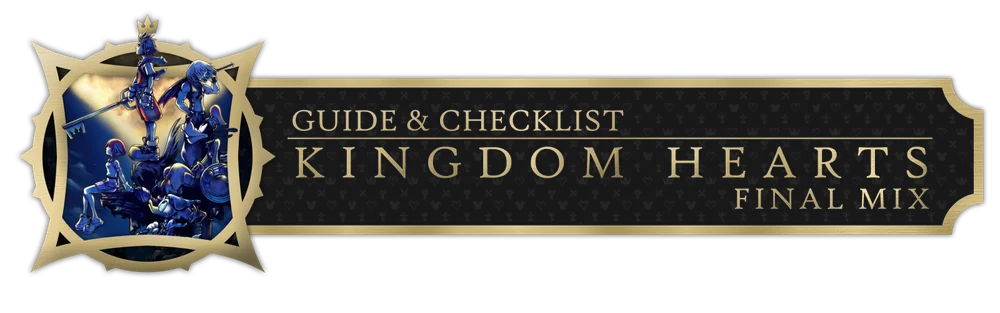
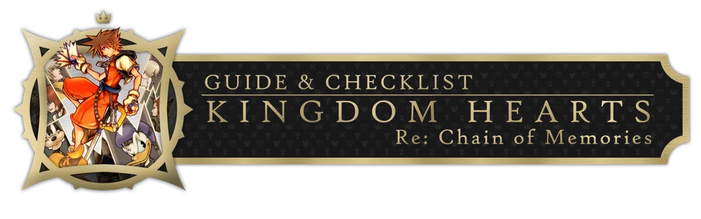
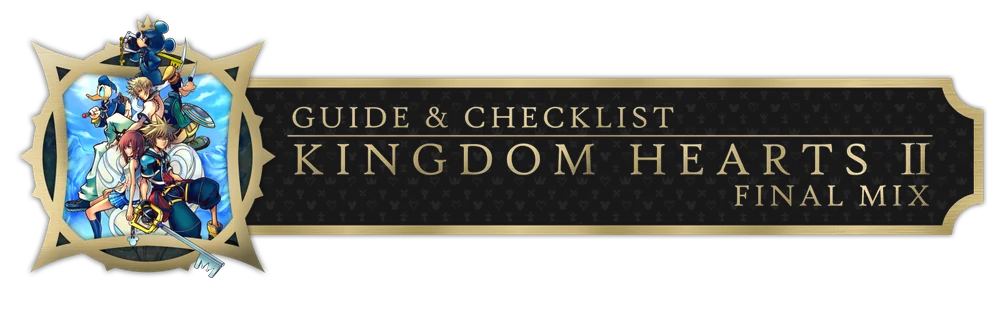
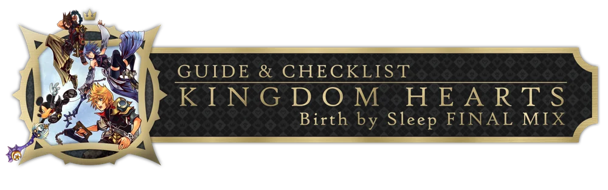
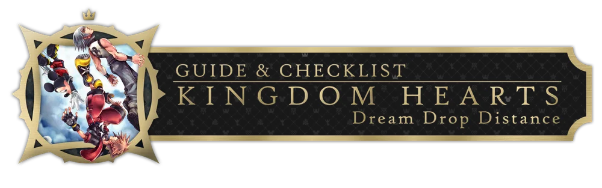
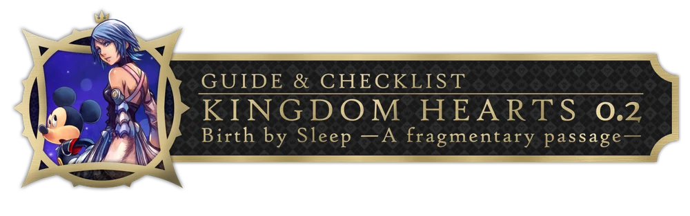
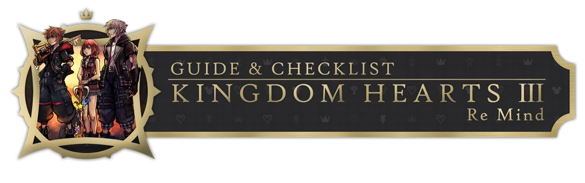

# ✦ Kingdom Hearts — Guides & Checklists ✦

**A 100% completion tracker for the whole Kingdom Hearts series, right in your browser.**

Trophies, reports, journal entries, synthesis, gummi missions, minigames and more,
across 7 games and nearly **7,000 checkable items**.

### [▶ Open the site](https://gh.rafaelviper.com.br/kh-check)

---

## 🗝️ Games

| | Game | Sections | Items |
|:---:|---|---|---:|
|  | **Kingdom Hearts Final Mix** | Journey · Arsenal · Synthesis & Gummi | 794 |
|  | **Kingdom Hearts Re:Chain of Memories** | General · Sora · Riku | 508 |
|  | **Kingdom Hearts II Final Mix** | Journey · Challenges · Synthesis & Gummi | 1,283 |
|  | **Kingdom Hearts Birth by Sleep Final Mix** | General · Terra · Ventus · Aqua | 1,888 |
|  | **Kingdom Hearts Dream Drop Distance** | General · Dream Eaters · Sora · Riku | 1,128 |
|  | **Kingdom Hearts 0.2 Birth by Sleep -A fragmentary passage-** | Checklist | 107 |
|  | **Kingdom Hearts III Re Mind** | Journey · Journal · Synthesis · Gummi | 1,251 |

Every game also has a **More Tips** tab with strategies and notes for the trickier collectibles.

## ✨ Features

- **Series hub**: one page with every game, its progress bar and the overall series percentage.
- **Progress saved in the browser**: no account, no server. Everything lives in `localStorage`.
- **Search** inside any list, plus **Hide completed** to see only what's left.
- **Bulk actions**: check or uncheck everything visible at once (respects the search filter).
- **Collapsible sections** with their own mini progress bars and video links where available.
- **Deep links**: the URL keeps the current tab and list (`kh3/#synthesis/...`), so you can bookmark exactly where you are.
- **Export / Import** progress as a `.json` file, and **Reset** when you want to start over.
- A themed look for each game, with the character, world and item icons from the original guides.

## 🙏 Credits

All checklist data and the original guides are by **[xenodusk](https://xenodusk.carrd.co/)**. This project just turns them into an interactive tracker. Go check out the originals!

Kingdom Hearts is a trademark of Square Enix and Disney. This is an unofficial fan project with no affiliation to either company. All game images belong to their respective owners.
